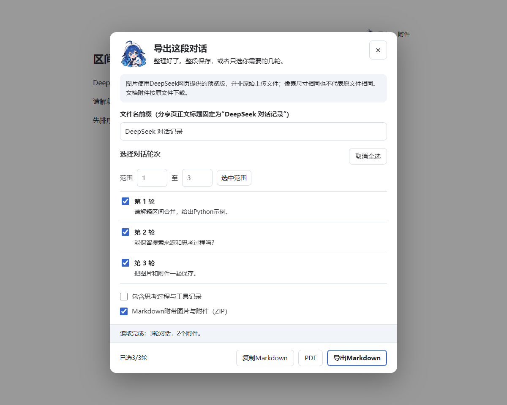
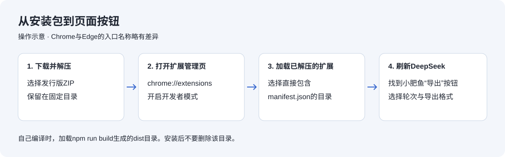
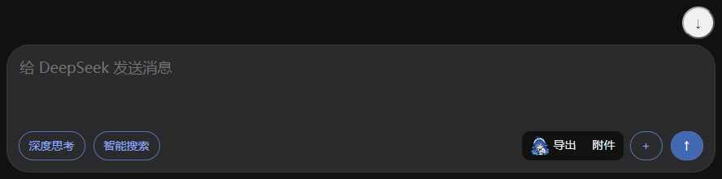
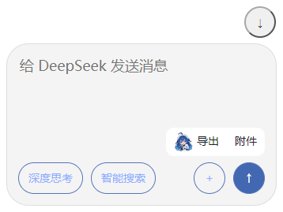
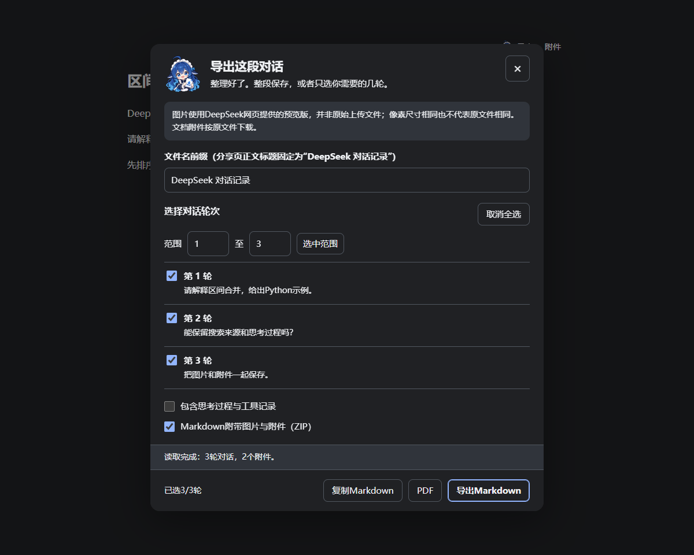
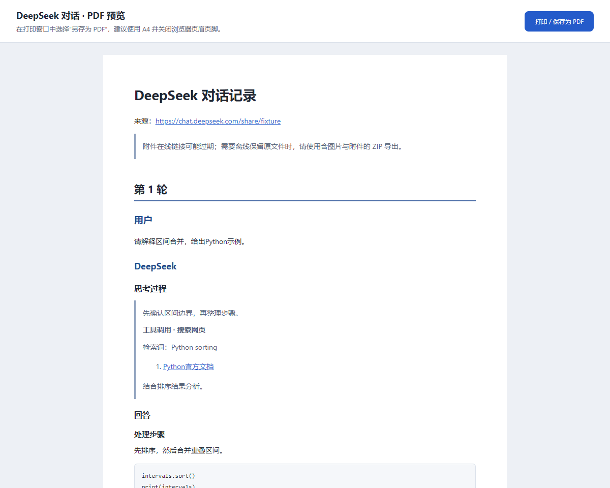
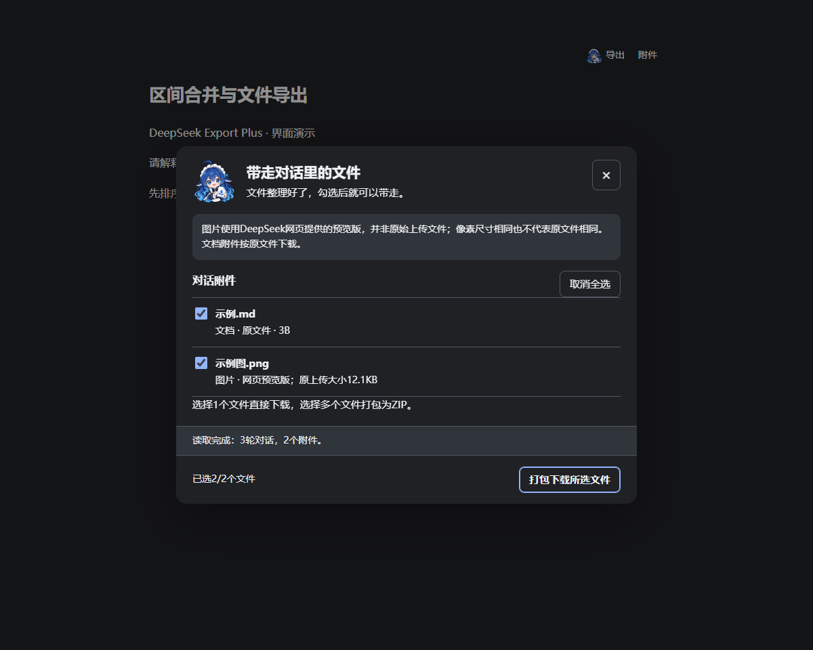

# DeepSeek Export Plus｜Chrome、Edge等Chromium桌面浏览器的对话导出插件

**DeepSeek网页对话导出浏览器插件**。把chat和share页面里的对话保存为Markdown、带附件的ZIP，或通过打印预览保存为PDF。可以选择部分轮次，也可以把思考、搜索记录和图片一起带走。

[下载安装包](https://github.com/xiaohei07/DeepSeek-Export-Plus/releases/latest) · [报告问题](https://github.com/xiaohei07/DeepSeek-Export-Plus/issues) · [开发与验证](docs/DEVELOPMENT.md)



## 为什么做这个插件

最初只是想把DeepSeek里的对话保存下来。我试过[ds.aikeyu.cn](https://ds.aikeyu.cn/)，它的导出效果给了我不少参考，不过免费额度对我来说实在有点不够用，频繁导出就会碰到收费问题，于是想做一个能在本地使用、自己也能修改的版本。

这里还是要感谢他们在对话导出上的工作。这个插件的效果**不一定比他们的好**，不同对话、公式和页面版本都可能影响结果。它更适合希望长期保存对话、不想为导出次数付费，并且愿意在网页改版后一起反馈问题的人。

项目基于[sati0121/DeepSeek-Exporter](https://github.com/sati0121/DeepSeek-Exporter)继续开发。原作者提供了浏览器插件的基础，让后续修改有了起点。随着导出流程和数据提取方式的调整越来越多，这里选择独立维护，保留原作者署名和MIT许可证。

## 可以导出什么

| 内容 | 处理方式 |
| --- | --- |
| 普通对话与分享页 | 支持`chat.deepseek.com`下的chat、share页面；兼容范围取决于当前网页结构 |
| 全部或部分对话 | 全选、逐轮勾选、指定连续范围；保留原轮号和该轮用户/DeepSeek内容 |
| 思考与工具记录 | 默认关闭，勾选后导出，统一放在引用块中，不额外加斜体；保留可取得的搜索词和来源链接 |
| 代码、表格、公式 | 保留Markdown结构；代码有语言时标明语言，没有时使用`text`，结束围栏单独换行 |
| 图片与文档附件 | 对话ZIP内保存图片、附件和清单；附件窗口选1个直接下载，选多个打包为ZIP |
| PDF | 打开本地打印预览，再选择“另存为PDF”；文字可选择，图片与数学公式在预览中渲染 |
| 标题与层级 | share正文标题固定为“DeepSeek 对话记录”，chat保留可编辑标题；按“第x轮→用户/DeepSeek→思考/回答”组织 |
| 下载名称 | 对话MD、ZIP及PDF建议名称加入本地导出时间，精确到秒，方便区分多次导出；单独的附件保留原文件名 |

图片需要单独说明：**DeepSeek上传图片使用网页提供的预览版，不保证是原始上传文件。**预览图有时与原图尺寸相同，文件格式、压缩或元数据仍可能不同。插件会在选择导出时说明，并在文件名和附件清单里标记。文件列表中的“原上传大小”来自网页元数据，下载后的实际字节数见附件清单，两者不能混为一谈。PPTX、MD、HTML、DOCX、PDF等文档附件按取得的原文件下载，不把提取出来的预览文字改名冒充原文件。

## 安装

适用于Chrome、Edge等基于Chromium的桌面浏览器，要求内核版本120及以上。当前没有发布到浏览器扩展商店。

1. 在[Releases](https://github.com/xiaohei07/DeepSeek-Export-Plus/releases/latest)中下载`DeepSeek-Export-Plus-版本号.zip`。如果只有源码，按下面的“本地编译”生成安装包。
2. 解压到一个固定目录，确认目录中直接包含`manifest.json`。安装后保留这个目录，浏览器仍会从这里加载插件。
3. Chrome打开`chrome://extensions`，Edge打开`edge://extensions`，开启**开发者模式**。
4. 点击**加载已解压的扩展程序**，选择上面含有`manifest.json`的目录。不要直接选择ZIP，也不要选择源码的`public`目录。
5. 回到DeepSeek，**刷新已打开的对话页面**。输入区右侧会出现小肥鱼“导出”和“附件”按钮；空间不足时放在输入框内的独立一行，没有输入区时放在对话内容顶部。



更新时，将新版解压到固定目录，在扩展管理页面点击插件的“重新加载”，然后刷新DeepSeek页面。旧插件和本插件同时启用时可能出现重复按钮，建议只保留一个启用。

导出入口使用独立容器，空间足够时放在上传按钮左侧；窄窗口会在输入框内单独占一行，避开原网页的“回到底部”按钮。





## 导出一段对话

打开自己需要保存的DeepSeek对话或分享页，等待回复完成，再点击“导出”。下方截图继续用区间合并的缩减示例说明界面，实际导出按自己的内容选择即可。

窗口会先读取对话。分享页优先读取原始分享内容；chat页面会结合当前消息数据与页面内容，必要时滚动加载历史。默认不展开思考，只有勾选思考并执行导出时才补读，完成后恢复位置和折叠状态。长对话需要一些时间，期间不要切换对话；关闭窗口可停止后续处理。

读取完成后，chat可以修改文档标题；share正文标题固定为“DeepSeek 对话记录”，输入框只修改文件名前缀，避免把第一段长提示词当作整篇标题。下载名称会自动附上导出时间，例如`DeepSeek 对话记录_2026-10-23_18-30-05.md`，时间不会写进正文主标题。

默认选中全部轮次，需要局部保存时，可以逐轮勾选，或输入起止轮次后点击“选中范围”。例如只选择第2至第3轮，导出的文档仍会写“第2轮”和“第3轮”，方便回到原对话核对。



两项勾选分别决定导出内容：

- **包含思考过程与工具记录**：默认不选。勾选后，思考文字、搜索和打开网页的记录一起放进引用块。取消后保留正文及正文来源。
- **Markdown附带图片与附件（ZIP）**：勾选后下载可取得的文件，并把Markdown中的图片地址改为相对路径。有附件时生成ZIP，没有附件时直接生成MD；取消后保留在线链接。

“复制Markdown”适合临时粘贴，不下载附件。“导出Markdown”适合保存到本地笔记。ZIP解压后打开`对话.md`即可，移动文档时请把同级`assets`目录一起移动。`附件清单.json`会记录实际保存的文件、字节数和失败原因。

## 保存PDF

在同一个窗口中选择轮次和思考选项，点击“PDF”。插件会打开独立预览页，等待图片和字体就绪后，再点击**打印 / 保存为PDF**。



在浏览器打印窗口中，把目标打印机选为“另存为PDF”，建议使用A4，并关闭浏览器自动添加的页眉页脚。PDF中的图片会尝试嵌入；文档附件保留链接，完整文件仍建议用ZIP保存。

## 单独下载文件

点击页面上的“附件”，小肥鱼会先整理当前对话里的文件。文件列表会区分文档和图片预览版。**选1个时，点击“下载所选文件”直接保存；选多个时，按钮变为“打包下载所选文件”，只生成一个ZIP。**附件ZIP名称也带导出时间，内部文件保留原名称并加序号。单张图片仍会标记“预览”并使用实际图片格式的扩展名。



多个文件中有部分读取失败时，其余文件仍会打包，失败文件和原因写入`附件清单.json`。窗口显示成功和失败数量；如果全部失败，ZIP中只保留清单。单个文件失败时直接显示原因，不下载空壳ZIP。签名地址过期时，可以刷新对话后重新读取；网页本身不再提供的文件，插件也无法恢复。取消保存或下载是否完成，以浏览器下载列表为准。

以上界面截图由真实插件在隔离测试页中生成，示例对话经过缩减，便于说明操作。完整的附件测试使用了[附件说明与多语言测试分享页](https://chat.deepseek.com/share/wwcwocs4nett58pwcl)的数据；没有把用户原始附件或临时下载地址放进源码仓库。

## 本地编译

建议使用Node.js24和npm。克隆或下载源码，在项目根目录执行：

```bash
npm ci
npm run build
```

将生成的`dist`目录作为已解压扩展加载。需要可分发的安装包时执行：

```bash
npm run package
```

安装包位于`output`目录。源码中的依赖版本由`package-lock.json`固定，构建会把第三方许可证一起放进安装包。构建不需要DeepSeek账号、API密钥或后端服务。

运行测试：

```bash
npm test
npx playwright install chromium
npm run test:browser
```

浏览器测试使用临时独立配置和模拟页面，不读取自己的浏览器账号。也可以通过`DSX_TEST_BROWSER`指定已有的Chrome for Testing可执行文件。测试详情和当前边界见[验证记录](docs/VALIDATION.md)。

## 隐私与权限

导出在浏览器本地处理，没有上传对话的自建服务，也没有统计或遥测。插件只在`chat.deepseek.com`运行。分享内容和附件仍需向DeepSeek自己的服务请求；正文中的远程图片也可能需要向原图片地址请求，是否能下载取决于对方的跨域设置。

| 权限 | 用途 |
| --- | --- |
| `scripting`及DeepSeek页面权限 | 读取当前挂载消息的必要字段，补充折叠思考、工具和附件信息 |
| `files.deepseeksvc.com` | 下载DeepSeek提供的文件与图片预览 |
| `clipboardWrite` | 用户点击后复制Markdown |
| `storage` | 暂存PDF预览内容，关闭预览后清理；不用于长期保存对话 |

chat页面还会在内存中保留当前页面自然收到的历史消息响应，只选择对话字段，不读取Cookie、令牌或请求头，不主动重放认证请求。刷新页面或切换会话后不会把上一会话的数据用于当前导出。实现说明见[开发说明](docs/DEVELOPMENT.md)。

## 已知限制与常见问题

**为什么有些像代码的句子没有代码块？**

如果原回答本来就是普通段落，例如`count += delta; if count==1 ...`，插件会按原结构保存。它不调用AI猜测哪些自然语言应该改成代码块。原文已有代码块时会保留围栏；需要重新整理这类伪代码，可以导出后自行包裹，或者让DeepSeek原回答使用代码块。

**chat中仍然少了思考或工具怎么办？**

先确认回复已结束，再重新加载插件并刷新网页。新装插件之前已经收到的历史响应不会倒流到缓存里，提取器会尝试从当前消息和页面补充。若仍不完整，可以对同一对话使用share页面导出，并提交缺失位置和版本信息。网页隐藏或未返回的工具结果无法凭空补全；完整消息和分组快照按原顺序导出，DOM回退按可确认的位置排列；两者都无法恢复网页没有提供的记录。正文来源已知但引用位置丢失时，会列在该条回答末尾并注明。

**分享页为什么使用固定标题？**

某些分享页没有可靠的对话标题，第一条问题又可能很长，也不能代表整段内容。2.1.1起，share正文统一使用“DeepSeek 对话记录”，文件名通过时间区分，也可以修改文件名前缀。chat仍优先使用对话标题，取不到时回退到第一条问题，导出前可以手动修改。文件名中的非法字符会替换。

**附件或PDF太大怎么办？**

单个附件上限40MB，ZIP附件合计上限100MB，PDF嵌入图片合计上限5MB。超过时会在文档或窗口中说明，建议减少轮次、分批下载，或使用ZIP保存图片。PDF预览暂存在浏览器内存会话存储里；打开大量预览时，旧预览的临时数据可能被清理，重新载入旧页需要再次导出。

**是否保证所有DeepSeek网页版都有效？**

支持范围是当前桌面网页版的chat和share路由。DeepSeek的内部数据结构和页面类名都可能变化，插件无法保证未来版本、所有账号灰度界面或每种未见过的工具类型都兼容。暂未适配原生App、Firefox和Safari。

## 近期更新

- **2.0.1整理阶段（未单独发行，合入2.1.0）**：合并开发、界面和贡献说明，整理原项目到Plus的改动来源。
- **2.1.0**：默认关闭思考导出；补充chat分散存储的思考、搜索及打开网页记录，按可确认的原位置排列；优化已全部加载的长对话读取、页面刷新后的按钮位置；附件改为一次ZIP下载，并补充正文来源。
- **2.1.1**：修复导出按钮挤动发送按钮的问题；share正文改用固定标题，对话下载名称附上时间；单附件直接下载，多附件继续打包，并修正过长附件名和空文件处理。

此前1.x本地迭代及2.0.0的变化见[更新记录](CHANGELOG.md)，具体测试范围见[验证记录](docs/VALIDATION.md)。

## Contributors

| 贡献者 | 参与内容 |
| --- | --- |
| [sati0121](https://github.com/sati0121) | 上游DeepSeek-Exporter原作者，提供项目基础 |
| [07xiaohei（xiaohei07）](https://github.com/xiaohei07) | 需求、使用反馈与项目维护 |
| GPT（通过Codex） | 协助代码实现、排错、测试与文档整理 |

## 致谢与许可

- [sati0121/DeepSeek-Exporter](https://github.com/sati0121/DeepSeek-Exporter)：原项目与MIT授权。
- [ds.aikeyu.cn](https://ds.aikeyu.cn/)：对话导出服务及效果参考。
- Turndown、Marked、DOMPurify、KaTeX、fflate等开源库：承担格式转换、渲染和打包工作，见[第三方说明](docs/THIRD_PARTY_NOTICES.md)。

代码继续使用[MIT许可证](LICENSE)。允许修改、再分发和独立发布，也允许商业使用；再分发时保留原作者版权及许可文本，并遵守所带依赖的许可证。本项目不是DeepSeek官方插件。小肥鱼图标为参考用户提供形象生成的项目插画，来源说明见[图像说明](docs/ASSETS.md)。
